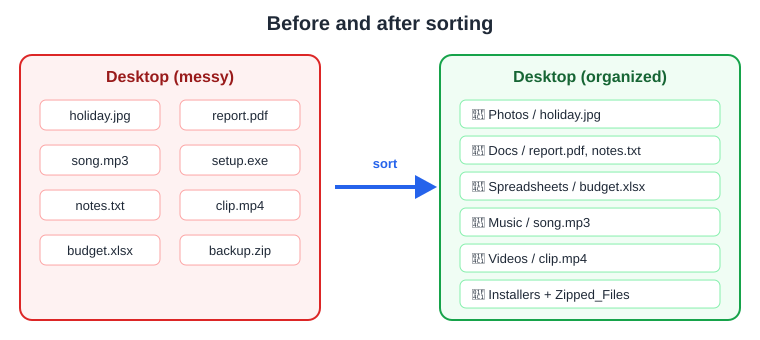
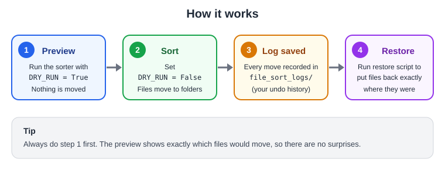
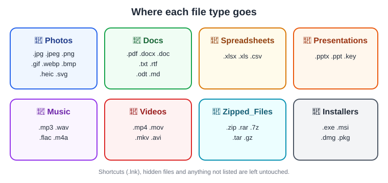

# File Sorter and Restorer

Two small Python scripts that tidy up your **Desktop**, **Downloads** and **Documents** folders by sorting files into folders by type, and can **undo everything** if you change your mind.



---

## What's included

| File | What it does |
|------|--------------|
| `sort_my_files.py` | Sorts loose files into folders like Photos, Docs, Music |
| `restore_my_files.py` | Puts every file back where it was before the sort |
| `images/` | Diagrams used in this README |

---

## Requirements

- Python 3.8 or newer (https://www.python.org/downloads/)
- No extra packages needed. Everything used is built into Python.

---

## How it works



### Step 1: Preview (safe, moves nothing)

Open `sort_my_files.py` and check the top of the file:

```python
DRY_RUN = True
```

Run it:

```
python sort_my_files.py
```

You'll see lines like:

```
=== C:\Users\Prem\Desktop ===
[preview] holiday.jpg  ->  Photos/
[preview] report.pdf  ->  Docs/
```

### Step 2: Sort for real

If the preview looks right, change the setting:

```python
DRY_RUN = False
```

Run it again. Your files move into their folders.

### Step 3: The undo log

Every real run saves a record of each move to:

```
<your home folder>/file_sort_logs/move_log_YYYY-MM-DD_HH-MM-SS.json
```

**Don't delete this folder.** It is your only way back.

### Step 4: Restore (undo)

Open `restore_my_files.py`. Like the sorter, it starts in preview mode:

```python
DRY_RUN = True
```

Run it to see what would be restored, then set it to `False` and run again:

```
python restore_my_files.py
```

Files return to their original locations, and the folders the sorter created are removed if they're empty.

---

## Where each file type goes



You can change this by editing the `FILE_BLUEPRINT` section near the top of `sort_my_files.py`. For example, to send `.epub` files to a Books folder, add:

```python
".epub": "Books",
```

---

## Safety features

- **Preview first:** `DRY_RUN` is on by default in both scripts.
- **Never overwrites:** if `report.pdf` already exists in the target folder, the new file becomes `report (1).pdf`.
- **Skips risky files:** shortcuts, hidden files, locked files and the script itself are left alone.
- **Top level only:** files already inside your own folders are not touched.
- **Full undo:** every move is logged and can be reversed.

---

## Choosing which folders get sorted

Edit `CANDIDATE_FOLDERS` in `sort_my_files.py`:

```python
CANDIDATE_FOLDERS = [
    home / "Desktop",
    home / "OneDrive" / "Desktop",
    home / "Downloads",
    home / "Documents",
]
```

> **Warning:** Don't add system locations such as `C:\`, `Program Files`, `AppData`, or folders that contain code projects. Moving files there can break programs.

---

## Troubleshooting

| Problem | Fix |
|---------|-----|
| `No undo logs found` | The restore only works for real runs (`DRY_RUN = False`) made with the updated `sort_my_files.py`. |
| A file was skipped as "in use or locked" | Close the program using it and run the sorter again. |
| Restored file is named `name (restored 1).ext` | A new file already existed at the original spot, so nothing was overwritten. |
| Images don't show in this README | Open it in VS Code (Ctrl+Shift+V for preview), GitHub, or any Markdown viewer. Notepad shows plain text only. |

---

## Tip

For extra peace of mind, copy your Desktop to a backup folder before the first real run.
